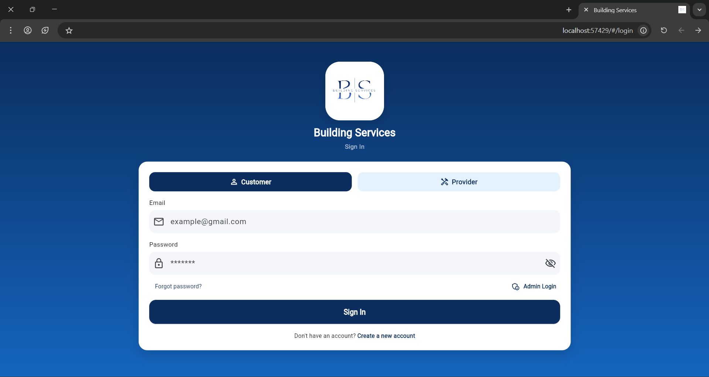
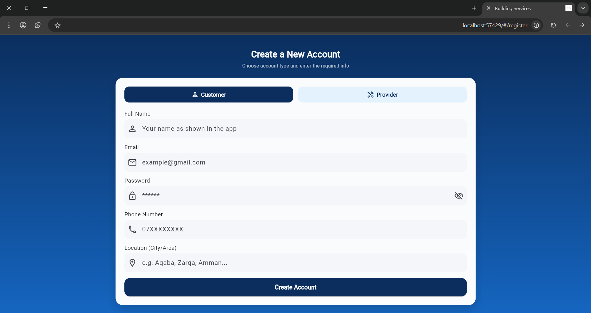
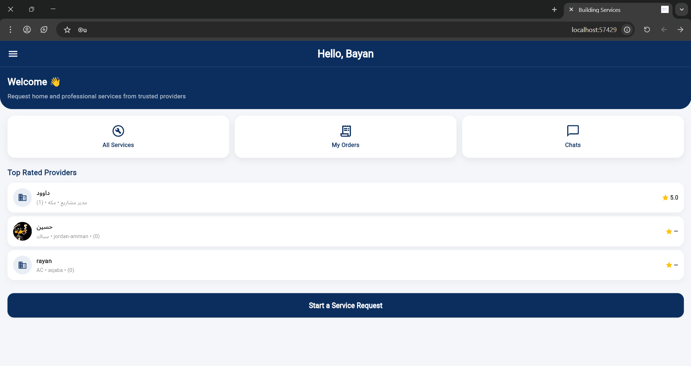
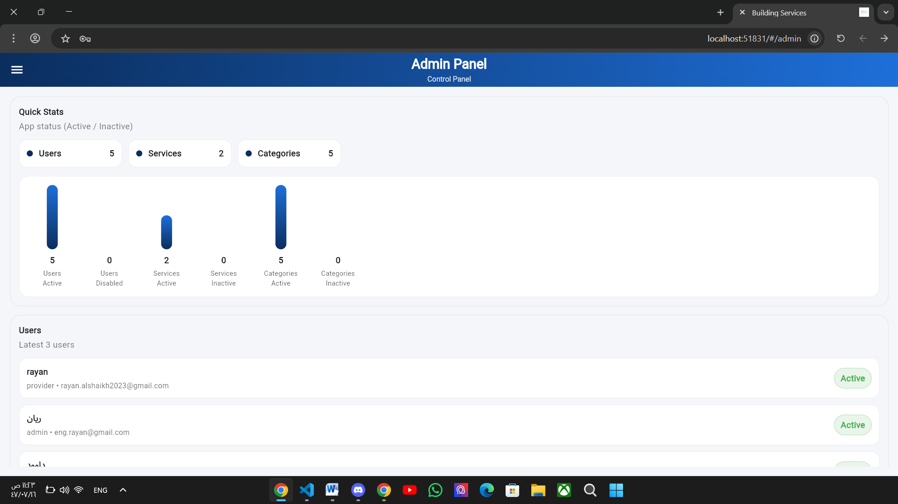
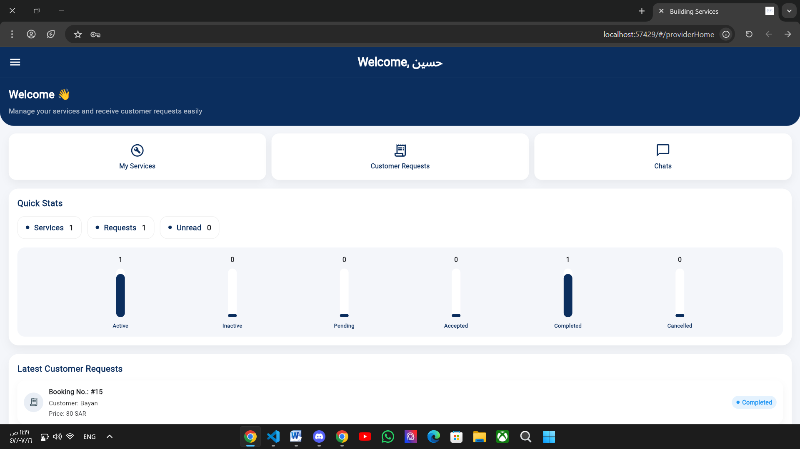
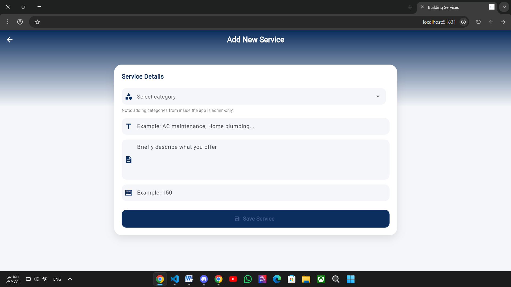
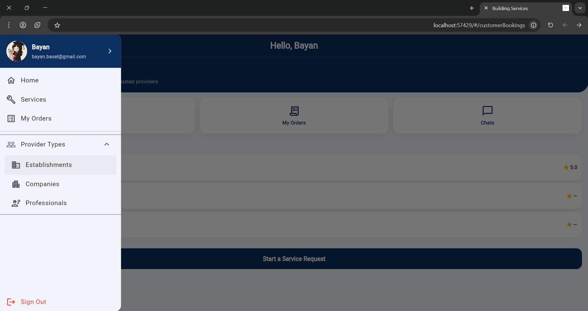

# BS - Building Services

Cross-platform mobile application developed as a Software Engineering graduation project using Flutter, Dart, and Firebase.

**Graduation Project Grade: 95/100**

## Project Overview

BS - Building Services is a cross-platform mobile application designed to provide a scalable, cloud-based service platform for Android and iOS from a single codebase.

The application integrates mobile frontend development with cloud-based backend services, real-time data synchronization, secure authentication, cloud storage, push notifications, and structured state management.

The project was developed and managed using Agile/Scrum practices throughout the development lifecycle.

## Tech Stack

- Flutter
- Dart
- Firebase Authentication
- Cloud Firestore
- Firebase Cloud Storage
- Firebase Cloud Messaging (FCM)
- Firebase Cloud Functions
- Git / GitHub

## Key Features

- Cross-platform support for Android and iOS
- Responsive and native-like user interface
- Secure user registration and login
- User account management
- Real-time data synchronization using Cloud Firestore
- Cloud-based image and file storage
- Push notifications for user events and interactions
- Conversation-related notifications
- Structured state management
- Scalable cloud database design
- Separation between UI and business logic

## Software Engineering Practices

- Object-Oriented Programming (OOP)
- Software Architecture
- Requirements Analysis
- Database Design
- Clean Code
- Separation of Concerns
- State Management using BLoC / Provider concepts
- Testing and Debugging
- Version Control using Git / GitHub
- Agile / Scrum Development

## Architecture

The application was designed using a structured architecture that separates the presentation layer from the application logic and cloud services.

- Mobile Application
- Presentation Layer
- Business Logic / State Management
- Firebase Services
- Authentication
- Cloud Firestore
- Cloud Storage
- Firebase Cloud Messaging (FCM)
- Cloud Functions

## My Role

I contributed across the full software development lifecycle, including:

- Analyzing system requirements and translating them into application features
- Designing the application structure and architecture
- Developing the mobile user interface using Flutter and Dart
- Designing and integrating Cloud Firestore data structures
- Implementing Firebase Authentication and user management
- Integrating Firebase Cloud Storage
- Implementing real-time data synchronization
- Integrating Firebase Cloud Messaging for notifications
- Applying OOP and clean code principles
- Separating presentation logic from business logic
- Managing application state using BLoC / Provider concepts
- Debugging and resolving software issues
- Performing functional testing and validation
- Using Git / GitHub for version control
- Managing project activities using Agile / Scrum practices

## Project Outcome

The project resulted in a fully developed cross-platform mobile application integrating:

**Mobile Frontend + Cloud Backend + Database + Authentication + Storage + Real-Time Synchronization + Push Notifications + Application Architecture**

The application was presented and evaluated as a graduation project and achieved a final grade of **95/100**.

## Screenshots

<table>
  <tr>
    <td></td>
    <td></td>
  </tr>
  <tr>
    <td><b>Login</b></td>
    <td><b>Registration</b></td>
  </tr>

  <tr>
    <td></td>
    <td></td>
  </tr>
  <tr>
    <td><b>Home</b></td>
    <td><b>Admin Panel</b></td>
  </tr>

  <tr>
    <td></td>
    <td></td>
  </tr>
  <tr>
    <td><b>Provider Home</b></td>
    <td><b>Add New Service</b></td>
  </tr>

  <tr>
    <td></td>
  </tr>
  <tr>
    <td><b>Navigation / Side Panel</b></td>
  </tr>
</table>

## Demo

Application demo will be added here.

## Author

**Rayan Mohammed Alshaikh Ali**

Software Engineering Graduate

Madinah, Saudi Arabia

LinkedIn: https://www.linkedin.com/in/rayan-ali-bab755384

Email: rayan.alshaikh2023@gmail.com
